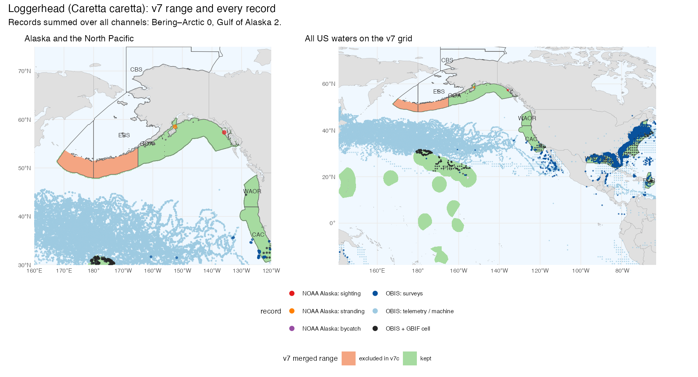
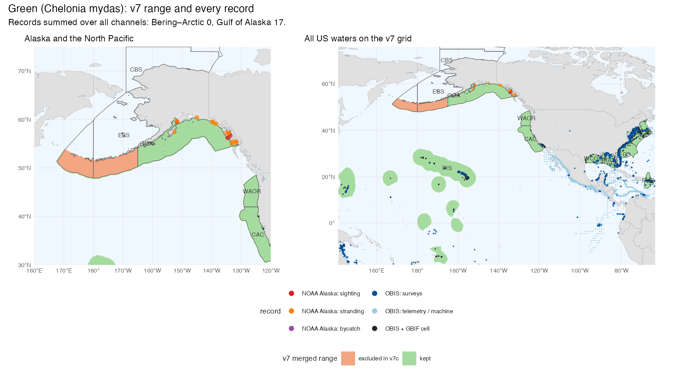
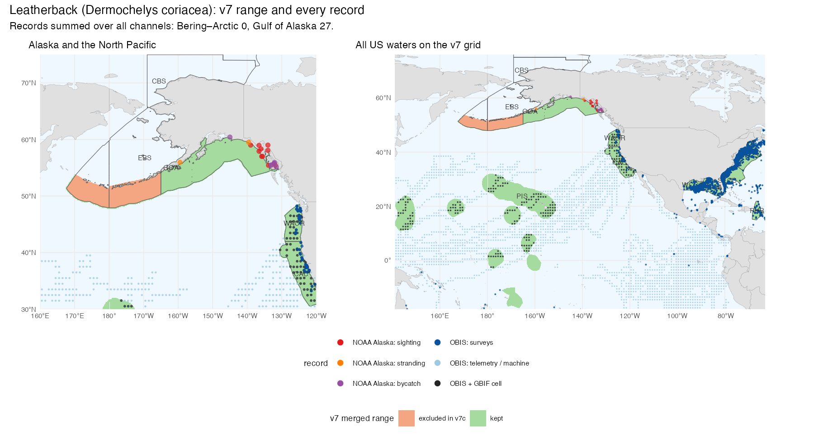
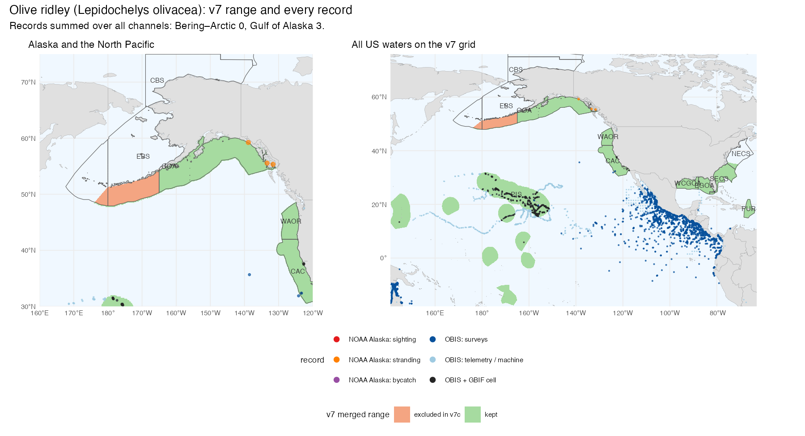
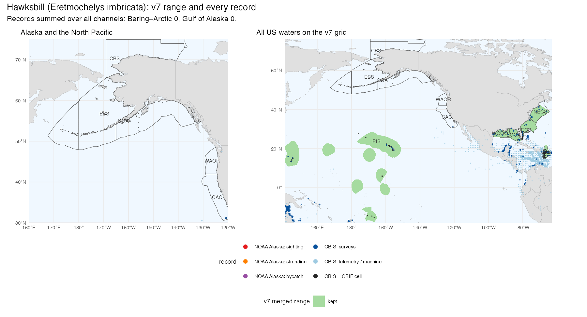
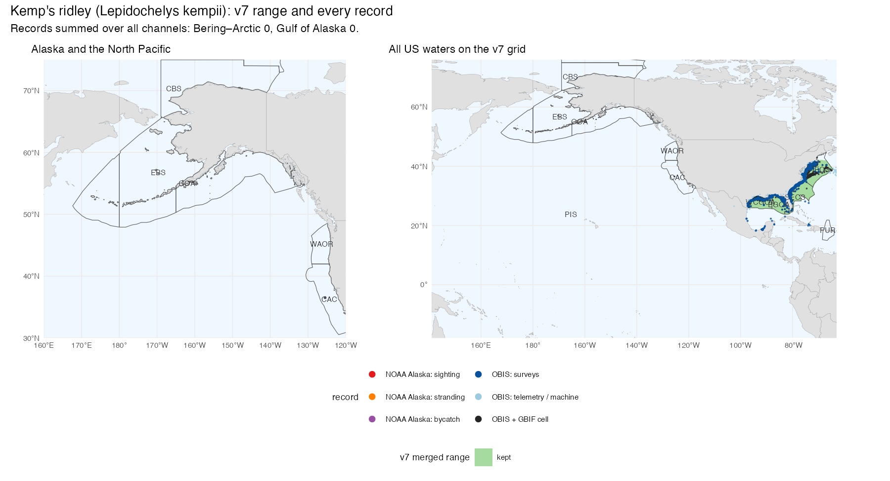

```{r}
#| include: false
# body of releases/v7c.qmd, knitted as a child (see the gate there). Every number
# in this chapter is read from a file in data/v7c/, copied from the workflows
# build that produced it:
#   zone_exclusions.csv, records_species_ecoregion.csv, right_whale_records.csv,
#   looking_vs_finding.csv, sources.csv          <- build_v7c_exclusions.qmd
#   tbl_attribution_programarea_v7c.csv, tbl_gates_v7c.csv,
#   tbl_component_not_reportable_programarea_v7c.csv, build_v7c.json  <- build_v7c.qmd
#   tbl_attribution_programarea_v7b.csv                               <- build_v7b.qmd
library(dplyr)
v7c_csv <- function(f) as.data.frame(readr::read_csv(
  here::here("data/v7c", f), show_col_types = FALSE, progress = FALSE))
v7c_kbl <- function(d, caption, align = NULL)
  knitr::kable(d, caption = caption, align = align, row.names = FALSE)

x_ex   <- v7c_csv("zone_exclusions.csv")
x_rec  <- v7c_csv("records_species_ecoregion.csv")
x_rw   <- v7c_csv("right_whale_records.csv")
x_lf   <- v7c_csv("looking_vs_finding.csv")
x_src  <- v7c_csv("sources.csv")
x_att  <- v7c_csv("tbl_attribution_programarea_v7c.csv")
x_att7b <- v7c_csv("tbl_attribution_programarea_v7b.csv")
x_gate <- v7c_csv("tbl_gates_v7c.csv")
x_nr   <- v7c_csv("tbl_component_not_reportable_programarea_v7c.csv")
x_man  <- jsonlite::read_json(here::here("data/v7c/build_v7c.json"))
kappa_pct <- 100 * x_man$coverage_floor

# names: the species v7c touches (v7 mdl_seq), ecoregions and Program Areas from
# the book's own zone geometry
sp <- data.frame(
  mdl_seq = c(54238L, 54239L, 54240L, 54241L, 54242L, 54243L, 54252L),
  aphia   = c(137205L, 137206L, 137207L, 137209L, 137208L, 220293L, 159023L),
  species = c("Loggerhead", "Green", "Hawksbill", "Leatherback", "Kemp's ridley",
              "Olive ridley", "North Atlantic right whale"))
eco <- sf::st_drop_geometry(sf::st_read(
  here::here("data/ply_ecoregions_2025.gpkg"), quiet = TRUE))[, c("ecoregion_key", "ecoregion_name")]
eco_name <- setNames(eco$ecoregion_name, eco$ecoregion_key)
pra <- sf::st_drop_geometry(sf::st_read(
  here::here("data/ply_programareas_2026_v4.gpkg"), quiet = TRUE))[, c("programarea_key", "programarea_name", "region_name")]
pra$programarea_name <- sub("^GOA Program Area", "Gulf of America Program Area", pra$programarea_name)
pra_name <- setNames(pra$programarea_name, pra$programarea_key)

f1 <- function(x) ifelse(is.na(x), "—", formatC(x, format = "f", digits = 1))
rank_of <- function(x) rank(-x, na.last = "keep", ties.method = "min")
att <- function(d, w, r) {
  v <- d$value[d$what == w & d$run == r]
  setNames(v, d$programarea_key[d$what == w & d$run == r])
}
```

v7c, titled **v7.2**, is the second surgical patch of the public v7 release, built the way v7b was. It is not a new build: v7's database is cloned, the merged models of six sea turtles and the North Atlantic right whale are edited under their existing model ids, and v7's own scoring is re-executed verbatim. It replaces v7b as the version under review. Three rules change, and nothing else does:

1. **The turtle record rule.** A sea-turtle species is dropped from an Alaska ecoregion where it has never been recorded through any observational channel: sightings, strandings, bycatch, fishery observers, survey and opportunistic records. This replaces v7b's suitability threshold.
2. **The right whale Gulf rule.** The North Atlantic right whale is dropped from the two Gulf of America ecoregions, which lie outside its range.
3. **The coverage floor κ**, carried over unchanged from v7b.

Productivity, the national score and everything else planned for v10 are untouched. Every primary-productivity row of v7c equals v7's, and a build gate checks this in every run.

```{r}
#| results: asis
if (identical(doc_access("v7c"), "restricted")) cat(sprintf(
"::: {.callout-important}
## Served on the review host only

v7c is a restricted pre-release. It is served only through the signed-in review host:
[Scores](%s), [Species](%s), [Atlas](%s) and [this documentation](%s). It is never what a reader gets by default, and promoting it is a
separate decision.
:::
", doc_app_url("scores", "v7c"), doc_app_url("species", "v7c"), doc_atlas_url("v7c"),
   doc_docs_url("v7c")))
```

## Three rules, each off in the control run

Each rule is a flag in the build notebook, and each flag's control value is *off*. With all three off, the same code reproduces v7 exactly: the same cells, the same values and the same scores. That gate makes every difference below attributable to one rule. The build also runs each rule on its own, so the Program-Area table further down shows what each rule moves.

| # | Rule | Unit | Flag (control = off) | Recorded in the release as |
|---|---|---|---|---|
| 1 | Turtle record rule | sea-turtle species × ecoregion | `EXCLUDE_TURTLES=0` | `turtle_record_rule` |
| 2 | Right whale Gulf rule | right whale × ecoregion | `EXCLUDE_RIGHT_WHALE=0` | `right_whale_gulf_rule` |
| 3 | Coverage floor κ | Program Area × component | `COVERAGE_FLOOR=0` | `coverage_floor_pct` |

: The three v7c rules. Rules 1 and 2 are one mechanism, a taxon × ecoregion exclusion read from one evidence table; the release records that table's digest as `zone_exclusions_hash`.

```{r}
#| results: asis
g <- x_gate
lbl <- c(all_off = "all rules off (control)", turtles_only = "record rule only",
         whale_only = "right whale rule only", kappa_only = "κ only", v7c = "v7c (all three)")
v7c_kbl(data.frame(
  Run                    = lbl[g$run],
  `Turtle cells`         = n_fmt(g$turtle_n),
  `Turtle cells removed` = n_fmt(g$turtle_diff),
  `Right whale cells`    = n_fmt(g$whale_n),
  `Right whale cells removed` = n_fmt(g$whale_diff),
  `Cells gained`         = n_fmt(g$turtle_gained + g$whale_gained),
  `Productivity == v7`   = ifelse(g$primprod_ok, "yes", "NO"),
  check.names = FALSE),
  caption = "Cells of the six merged sea-turtle models and the merged right whale model in each build run (`tbl_gates_v7c.csv`). The control run reproduces v7 with zero differences; no run adds a cell, and no run moves a productivity row.",
  align = c("l", rep("r", 5), "c"))
```

## The rules as equations

### A cell belongs to one ecoregion

Ecoregions are the unit of exclusion because they are the frame the score is rescaled in (@eq-ecoregion-rescale), and because the evidence is stated at that scale ("never recorded in the Bering Sea"; "the Gulf is outside its range"). A cell that straddles two ecoregions belongs to the one covering most of it:

$$
e(c) = \underset{e}{\arg\max}\; p_{c,e}
$$ {#eq-v7c-cell-ecoregion}

where $p_{c,e}$ is the percentage of cell $c$ covered by ecoregion $e$. A tie goes to the ecoregion whose key sorts first, so the assignment is deterministic (`msens::cell_zone_major_sql()`).

### Rule 1: the turtle record rule

For species $s$, Alaska ecoregion $e$ (Gulf of Alaska, East Bering Sea, Chukchi and Beaufort Seas, High Arctic) and observational channel $k$, let $n_{s,e,k}$ be the number of records of $s$ in $e$ from channel $k$, and $K_e$ the channels that reach $e$. Let $R_s$ be the cells of the species' v7 merged model. The species is dropped from the ecoregion when no channel has ever recorded it there and v7 gives it range there:

$$
\text{drop}_{s,e} \;=\; \mathbb{1}\!\left[\sum_{k \in K_e} n_{s,e,k} = 0\right] \cdot \mathbb{1}\!\left[\,\lvert \{c \in R_s : e(c) = e\} \rvert \ge 1\,\right]
$$ {#eq-v7c-record-rule}

The evidence table is built over the four Alaska ecoregions only; v7c does not apply the rule elsewhere. A channel that does not reach an ecoregion is left out of the sum rather than counted as a zero. A channel that reaches it and finds nothing counts as a zero. The rule is a yes/no question over all channels together; the channels are reported separately below so that what each can and cannot see stays visible.

### Rule 2: the right whale Gulf rule

$$
\text{drop}_{\textit{E. glacialis},\,e} = 1 \quad \text{for } e \in \{\text{EGOA},\ \text{WCGOA}\}
$$ {#eq-v7c-right-whale}

The evidence is of a different kind from rule 1: the species has a handful of Gulf records, all vagrants, against thousands in the Atlantic, and none of the independent range sources places it in the Gulf (see [The right whale](#sec-v7c-right-whale)).

### Applying a drop: critical habitat is never excluded

Both rules edit the merged model the same way (`msens::zone_exclude_sql()`):

$$
v'_{s,c} =
\begin{cases}
\text{absent} & \text{if } \text{drop}_{s,e(c)} = 1 \text{ and } c \notin H_s \\
v_{s,c} & \text{otherwise}
\end{cases}
$$ {#eq-v7c-apply}

where $v_{s,c}$ is the v7 merged value and $H_s$ the cells the species holds under a designated critical-habitat dataset. A dropped cell is removed from the model, not set to zero, and every kept cell keeps its v7 value exactly. No v7 critical habitat for these species lies in an excluded ecoregion, so the guard is asserted by the build rather than exercised (`n_ch_lost` = `r x_man$n_ch_lost` in `build_v7c.json`).

### Rule 3: the coverage floor κ

Unchanged from v7b. A component (a species category, or primary productivity) is reportable for a Program Area only where its scored cells cover enough of the area:

$$
\text{coverage}_{z,g} = \frac{\sum_{c \in z,\ \text{scored}} w_c}{\sum_{c \in z} w_c}
\,, \qquad \text{reportable}_{z,g} \iff \text{coverage}_{z,g} \ge \kappa
$$ {#eq-v7c-coverage}

with $w_c$ the share of cell $c$ inside Program Area $z$ and $\kappa$ = `r kappa_pct` %. Below the floor the component is not reportable: it is left out of the composite, never published as a zero.

### Why a drop, and not a weight

An alternative was worked through first: keep a turtle where it has been recorded rarely, but down-weight it by how rarely. The weight is the encounter rate per unit of looking, relative to a reference coast (California, Oregon and Washington), divided by what the distribution model already says about the same contrast (the encounter-rate notebook, @sec-v7c-links):

$$
w_{s,e} = \min\left(1,\; \frac{\lambda_{s,e} / \lambda_{s,\text{ref}}}{\bar S_{s,e} / \bar S_{s,\text{ref}}}\right)
$$ {#eq-v7c-weight}

where $\lambda$ is turtles found per unit of looking and $\bar S$ is mean modeled suitability per cell. v7c does not use it, because a weight cannot reach the score:

- **The ecoregional rescale cancels it.** Each component is rescaled to 0–100 within its ecoregion (@eq-ecoregion-rescale). A weight $w$ shared by every turtle cell of an ecoregion scales the cell scores and both endpoints alike, so it divides out, apart from rounding to whole numbers (next point):
  $$
  \frac{w\,x_c - w\,x_{\min}}{w\,x_{\max} - w\,x_{\min}} = \frac{x_c - x_{\min}}{x_{\max} - x_{\min}}
  $$ {#eq-v7c-cancel}
  A weight that differs between species changes only the mix of species within the ecoregion.
- **The integer floor keeps every cell.** The scoring database stores merged values as integers floored at 1, $v' = \max(1, \mathrm{round}(w\,v))$. Even $w = 0$, which is what a species never recorded gets, leaves the species in every cell at a value of 1. That is a flat surface the rescale treats like any other, and it still counts in the composite.

A weight can therefore at most reshuffle species within an ecoregion; taking a species out of an ecoregion's score takes a drop. Where a species *has* been recorded, v7c keeps it at its v7 value. In the Gulf of Alaska the two fair comparisons disagree: the strandings line puts the weight at 1 for all four recorded species, while the iNaturalist line, which covers only the years since about 2008, would down-weight them strongly. The Alaska Region's records since 2003 (request 1 below) would settle which holds today.

## The evidence

The evidence notebook gathers every observational channel that could be obtained, counts records per species × ecoregion × channel, and writes the exclusion table this release applies. The build asserts that the exclusions it applies are exactly that table's rows.

### The channels

```{r}
#| results: asis
cite_keys <- function(k) {
  k <- trimws(unlist(strsplit(k, ";")))
  k <- sub("^hodge_wing2000$", "hodgewing2000", k[nzchar(k) & !is.na(k)])
  if (!length(k)) "" else paste0("[", paste0("@", k, collapse = "; "), "]")
}
s <- x_src[x_src$status %in% c("used", "cited"), ]
v7c_kbl(data.frame(
  Channel  = sub("^right whale: ", "right whale — ", s$channel),
  Records  = s$records,
  Coverage = s$coverage,
  Years    = ifelse(is.na(s$years), "", s$years),
  `Looking (effort proxy)` = ifelse(is.na(s$effort_proxy), "", s$effort_proxy),
  Source   = vapply(s$citation_key, cite_keys, ""),
  Use      = s$status,
  check.names = FALSE),
  caption = "Every observational channel used or cited (`sources.csv`). *used*: counted per species × ecoregion; *cited*: a published figure quoted from the report. The channels overlap — one record can be in OBIS, GBIF and a NOAA file at once — so they are never summed into a total, only asked the record rule's yes/no question.",
  align = rep("l", 7))
```

### Looking against finding

A zero means something only where somebody was looking. For each region and channel, the table gives the looking (that channel's effort proxy), the turtles found (any sea turtle species), and turtles per 1,000 units of looking.

```{r}
#| results: asis
reg <- c("Bering–Arctic", "Gulf of Alaska", "Pacific CA/OR/WA", "Gulf of America")
lf  <- x_lf
lf$cell <- ifelse(is.na(lf$n_effort),
  sprintf("%s turtles", n_fmt(lf$n_turtle)),
  sprintf("%s / %s (%s)", n_fmt(lf$n_turtle), n_fmt(lf$n_effort),
          formatC(signif(lf$rate, 2), format = "fg", big.mark = ",")))
ch  <- unique(lf$channel)
tab <- do.call(rbind, lapply(ch, function(k) {
  d <- lf[lf$channel == k, ]
  data.frame(Channel = k, Looking = d$effort[1],
             t(setNames(sapply(reg, function(r) if (r %in% d$region) d$cell[d$region == r] else "—"), reg)),
             check.names = FALSE)
}))
v7c_kbl(tab,
  caption = "Looking against finding (`looking_vs_finding.csv`): turtles found / looking (turtles per 1,000 units of looking), by region. Lines A–D pair turtles and effort from the same reporting channel; the OBIS, GBIF and iNaturalist rows count whole ecoregions. — = the channel does not reach the region.",
  align = c("l", "l", rep("r", 4)))
```

The Bering Sea to Arctic is the one region with a large amount of looking and no turtle on any channel. The Gulf of America shows what a turtle coast looks like on the same measures. Fishery observers in Alaska reported no sea turtle caught in federally managed fisheries in 2014 or 2015 [@benaka2019]; that line has no effort count of its own.

### Records per species in Alaska

```{r}
#| results: asis
ch_lbl <- c(noaa_ak_sighting = "NOAA AK sighting", noaa_ak_stranding = "NOAA AK stranding",
            noaa_ak_bycatch = "NOAA AK bycatch", ak_fishery_observer = "AK fishery observers",
            obis_all = "OBIS", obis_survey = "OBIS surveys", gbif = "GBIF", inat = "iNaturalist",
            speciesgrids = "OBIS + GBIF cells", wc_leatherback_strandings = "West Coast leatherback strandings")
eco_ak <- c("GOA", "EBS", "CBS", "HAR")
tu <- sp[sp$mdl_seq != 54252L, ]
r  <- x_rec[x_rec$eco %in% eco_ak & x_rec$aphia %in% tu$aphia, ]
ex_pairs <- paste(x_ex$taxon_id, x_ex$zone_key)
rows <- expand.grid(aphia = tu$aphia, eco = eco_ak, stringsAsFactors = FALSE)
tab <- do.call(rbind, lapply(seq_len(nrow(rows)), function(i) {
  d <- r[r$aphia == rows$aphia[i] & r$eco == rows$eco[i], ]
  vals <- sapply(names(ch_lbl), function(k) {
    j <- which(d$channel == k)
    if (!length(j) || !isTRUE(d$covers[j])) "" else n_fmt(d$n[j])
  })
  any_rec <- any(d$covers & !is.na(d$n) & d$n > 0)
  v7c <- if (paste(rows$aphia[i], rows$eco[i]) %in% ex_pairs) "**dropped**"
         else if (any_rec) "kept (recorded)" else "no v7 range"
  data.frame(Ecoregion = sprintf("%s (%s)", eco_name[rows$eco[i]], rows$eco[i]),
             Species = tu$species[match(rows$aphia[i], tu$aphia)],
             t(setNames(vals, ch_lbl)), `In v7c` = v7c, check.names = FALSE)
}))
v7c_kbl(tab,
  caption = "Sea-turtle records per Alaska ecoregion and channel (`records_species_ecoregion.csv`). A blank cell is a channel that does not reach that ecoregion or species; a 0 is a channel that reaches it and found nothing. *no v7 range*: never recorded, but v7 gives the species no range there, so there is nothing to drop. The seven West Coast leatherback strandings in Alaska are the same animals as the NOAA Alaska file's, so the columns must not be added across.",
  align = c("l", "l", rep("r", length(ch_lbl)), "l"))
```

Every turtle record in Alaska is in the Gulf of Alaska, and it holds at least one record for each of loggerhead, green, leatherback and olive ridley, which therefore keep their v7 values there. The East Bering Sea, where v7 gave those four species range, has no record of any of them on any channel. The Chukchi and Beaufort Seas and the High Arctic have no record either, but v7 gives no turtle range there. Hawksbill and Kemp's ridley have never been recorded in Alaska and have no v7 range in Alaska, the Washington/Oregon coast or California. The records summarize six decades of reports [@noaa_ak_turtles_2026; @hodgewing2000].

### Records against each species' range

Each map shows the species' v7 merged range (green where v7c keeps it, orange where it drops it) and every record that has a location: the NOAA Alaska file and OBIS at their coordinates, and OBIS + GBIF cells (which include the iNaturalist records) at cell centres. The left panel frames Alaska and the North Pacific, the right all US waters on the v7 grid; records outside the frame are cut. Each map's subtitle sums the records over all channels for the Bering–Arctic and the Gulf of Alaska.

::: {.panel-tabset}

#### Loggerhead

{#fig-v7c-turtle-cc fig-alt="Two maps of the loggerhead's v7 range. The East Bering Sea part along the Aleutians is orange (dropped in v7c); the Gulf of Alaska and the lower-48, Hawaii and territories ranges are green. Record points sit in the Gulf of Alaska and on the lower-48 coasts, none in the Bering Sea."}

#### Green

{#fig-v7c-turtle-cm fig-alt="Two maps of the green turtle's v7 range, orange along the Aleutians in the East Bering Sea and green elsewhere, with record points in the Gulf of Alaska and further south, none in the Bering Sea."}

#### Leatherback

{#fig-v7c-turtle-dc fig-alt="Two maps of the leatherback's v7 range: an orange band along the Aleutians (East Bering Sea, dropped) and green across the Gulf of Alaska, the West Coast, Hawaii and the Atlantic and Gulf coasts. NOAA Alaska sightings, strandings and bycatch cluster in Southeast Alaska; none lie in the Bering Sea."}

#### Olive ridley

{#fig-v7c-turtle-lo fig-alt="Two maps of the olive ridley's v7 range, orange in the East Bering Sea and green elsewhere in the Pacific, with record points in the Gulf of Alaska and further south."}

#### Hawksbill

{#fig-v7c-turtle-ei fig-alt="Two maps of the hawksbill's v7 range, all green: the Pacific islands, the Gulf of America, the Southeast Atlantic and the Caribbean. The Alaska and North Pacific panel is empty of range and records."}

#### Kemp's ridley

{#fig-v7c-turtle-lk fig-alt="Two maps of Kemp's ridley's v7 range, all green, along the northern Gulf of America and the Atlantic coast, with records dense along those coasts. The Alaska and North Pacific panel is empty of range and records."}

:::

### The right whale {#sec-v7c-right-whale}

In v7 the North Atlantic right whale's Gulf of America range comes from two inputs only: the IUCN range polygon, valued at a flat 50, and AquaMaps. Every other line of evidence stops at the Atlantic. Designated critical habitat lies entirely in the Atlantic. The OBIS distribution-model ensemble, at its 10th-percentile training-presence threshold, has no Gulf cell. The habitat-based density models of @roberts2016, fitted to line-transect surveys of both the Atlantic and the Gulf, model the species in the Atlantic only. The Gulf records are a handful against thousands in the Atlantic, channel by channel. They are vagrants: NOAA's 2006 release names the confirmed Gulf sightings of the time — 1963 off Longboat Key, 2004 off Panama City, and a mother and calf first seen off Corpus Christi in January 2006 [@noaa_sero2006; @ward_geiger2011].

```{r}
#| results: asis
rw_lbl <- c(
  obis_all = "OBIS records", obis_survey = "OBIS survey records", gbif = "GBIF records",
  inat = "iNaturalist observations", speciesgrids = "OBIS + GBIF 0.05° cells",
  noaa_2006_release = "confirmed sightings named by NOAA (2006)",
  obis_sdm_p10 = "OBIS SDM ensemble cells ≥ P10 threshold",
  v7_rng_iucn = "v7 input: IUCN range cells", v7_am_0.05 = "v7 input: AquaMaps cells",
  v7_ch_nmfs = "v7 input: critical habitat cells", v7_ms_merge = "v7 merged model cells")
cols <- c("EGOA", "WCGOA", "EGOA+WCGOA", "NECS", "SECS", "NECS+SECS")
tab <- do.call(rbind, lapply(names(rw_lbl), function(k) {
  d <- x_rw[x_rw$channel == k, ]
  data.frame(Channel = rw_lbl[[k]], Unit = d$unit[1],
             t(setNames(sapply(cols, function(e) {
               j <- which(d$eco == e); if (length(j)) n_fmt(d$n[j]) else "—" }), cols)),
             check.names = FALSE)
}))
names(tab)[names(tab) == "EGOA+WCGOA"] <- "Gulf total"
names(tab)[names(tab) == "NECS+SECS"]  <- "Atlantic total"
v7c_kbl(tab,
  caption = "North Atlantic right whale, Gulf of America (Eastern, EGOA; Western and Central, WCGOA) against the Atlantic (Northeast and Southeast Continental Shelf), by channel (`right_whale_records.csv`). The v7 rows are the cells v7 gave the species in each ecoregion, by input.",
  align = c("l", "l", rep("r", 6)))
```

{#fig-v7c-right-whale fig-alt="Four maps of the US Atlantic and Gulf of America with the two Gulf ecoregions outlined in red. The IUCN range and AquaMaps panels shade most of the northern Gulf; the critical-habitat panel shades only the Gulf of Maine and the Southeast Atlantic calving grounds; the records panel has dense points from Florida to Nova Scotia and about ten scattered points in the Gulf."}

### Interactive map and the rendered notebooks {#sec-v7c-links}

The evidence notebook's [interactive map](https://marinesensitivity.org/workflows/build_v7c_exclusions.html#interactive-map) overlays the v7 turtle range (species per cell), the right whale's v7 range, the excluded ecoregions and the records by channel, with layers toggled at the top right.

- [Evidence for v7c](https://marinesensitivity.org/workflows/build_v7c_exclusions.html) (`build_v7c_exclusions.qmd`): every channel, the per-species × ecoregion × channel table, the exclusion table and its assertions, and the maps.
- [Build v7.2](https://marinesensitivity.org/workflows/build_v7c.html) (`build_v7c.qmd`): the clone, the exclusions, the control runs, the gates, the Program-Area attribution and the reference digests.
- [Sea turtles in Alaska: encounter rates](https://marinesensitivity.org/workflows/explore_turtle-alaska-encounter.html) (`explore_turtle-alaska-encounter.qmd`): the encounter-rate weight (@eq-v7c-weight), the four lines of evidence with their posterior intervals, and why the rule became a drop.

## What changes on the map

```{r}
#| results: asis
v7c_kbl(data.frame(
  Species   = sp$species[match(x_ex$mdl_seq, sp$mdl_seq)],
  Ecoregion = sprintf("%s (%s)", eco_name[x_ex$zone_key], x_ex$zone_key),
  `v7 cells removed` = n_fmt(x_ex$n_cells_v7),
  `Records in the ecoregion` = n_fmt(x_ex$n_records),
  Reason    = x_ex$reason,
  check.names = FALSE),
  caption = "The exclusion table v7c applies (`zone_exclusions.csv`): one row per species × ecoregion, with the v7 cells removed. A turtle row has zero records on every channel that reaches the ecoregion; the right whale's records are OBIS + GBIF counts of vagrants. Cells elsewhere keep their v7 values.",
  align = c("l", "l", "r", "r", "l"))
```

On the map, the four turtle species disappear from the East Bering Sea, along the Aleutians and the Bering shelf, and remain in the Gulf of Alaska and everywhere south at their v7 values. The right whale disappears from the Gulf of America and remains along the Atlantic coast at its v7 values.

## What moved in the Program-Area scores

Scores move only where a rule removes cells, and the build's attribution table splits each move between the rules. The composite is the equally weighted mean of the reportable components (@sec-scoring).

```{r}
#| results: asis
k <- pra$programarea_key[order(pra$region_name, pra$programarea_key)]
k <- unique(c(k[pra$region_name[match(k, pra$programarea_key)] == "Alaska"], k))
v7  <- att(x_att, "composite", "v7")[k];      a_t <- att(x_att, "composite", "turtles_only")[k]
a_w <- att(x_att, "composite", "whale_only")[k]; a_k <- att(x_att, "composite", "kappa_only")[k]
v7c <- att(x_att, "composite", "v7c")[k];     v7b <- att(x_att7b, "composite", "v7b")[k]
r7 <- rank_of(v7); r7c <- rank_of(v7c); r7b <- rank_of(v7b)
d <- v7c - v7
v7c_kbl(data.frame(
  `Program Area` = sprintf("%s (%s)", pra_name[k], k),
  v7 = f1(v7), `record rule only` = f1(a_t), `right whale rule only` = f1(a_w), `κ only` = f1(a_k),
  v7c = ifelse(abs(d) > 0.05, paste0("**", f1(v7c), "**"), f1(v7c)),
  `Δ v7c − v7` = ifelse(abs(d) > 0.05, sprintf("%+.1f", d), "0"),
  `rank v7 → v7c` = ifelse(r7 == r7c, as.character(r7), sprintf("**%d → %d**", r7, r7c)),
  `v7b (rank)` = sprintf("%s (%d)", f1(v7b), r7b),
  check.names = FALSE),
  caption = "Composite score per Program Area: v7, each rule on its own, and v7c (`tbl_attribution_programarea_v7c.csv`), with v7b beside it (`tbl_attribution_programarea_v7b.csv`). Ranks are among the 20 Program Areas, highest first; ties share a rank. Bold marks a change from v7.",
  align = c("l", rep("r", 8)))
```

Three things move the composite, and nothing else does:

- **Aleutian Arc and St. George Basin lose their turtle component.** Both lie mostly in the East Bering Sea. The record rule removes all but a sliver of their turtle cells: the remaining cells belong by majority to the Gulf of Alaska ecoregion. κ then removes that sliver as not reportable (table below). The two rules together empty both Program Areas of turtles. With the record rule alone, the Aleutian Arc would keep a turtle component near 0 and average it into the composite (the *record rule only* column). St. George Basin's composite rises because the component it loses scored below its average. Dropping a component cannot raise any cell's sensitivity, but it changes which components the mean is taken over.
- **The Gulf of America Program Areas gain on mammals.** Removing the right whale from both Gulf ecoregions moves those ecoregions' marine-mammal minimum and maximum as well as the cell values, so the rescaled mammal component of GAA and GAB rises (second table below), and the composite with it.
- **Every other Program Area is unchanged.** Gulf of Alaska, Kodiak, Cook Inlet and Shumagin keep all four recorded turtle species at their v7 values, so their composites are v7's.

```{r}
#| results: asis
kt <- unique(x_att$programarea_key[x_att$what == "turtle" & x_att$run == "v7"])
kt <- k[k %in% kt]
nr <- setNames(x_nr$coverage, x_nr$programarea_key)
v7c_kbl(data.frame(
  `Program Area` = sprintf("%s (%s)", pra_name[kt], kt),
  v7 = f1(att(x_att, "turtle", "v7")[kt]),
  `record rule only` = f1(att(x_att, "turtle", "turtles_only")[kt]),
  `κ only` = f1(att(x_att, "turtle", "kappa_only")[kt]),
  v7c = f1(att(x_att, "turtle", "v7c")[kt]),
  `turtle coverage below κ in v7c` = ifelse(kt %in% names(nr),
    sprintf("%.3f %%", 100 * nr[kt]), ""),
  v7b = f1(att(x_att7b, "turtle", "v7b")[kt]),
  check.names = FALSE),
  caption = sprintf("Sea-turtle component per Program Area, rescaled 0–100 (`tbl_attribution_programarea_v7c.csv`, `tbl_component_not_reportable_programarea_v7c.csv`, v7b from `tbl_attribution_programarea_v7b.csv`). — = not reportable, or no turtle cells. The coverage column gives the share of the Program Area still carrying turtles after the record rule, for the pairs κ = %s %% removes.", kappa_pct),
  align = c("l", rep("r", 6)))
```

```{r}
#| results: asis
km <- c("GAA", "GAB")
v7c_kbl(data.frame(
  `Program Area` = sprintf("%s (%s)", pra_name[km], km),
  v7 = f1(att(x_att, "mammal", "v7")[km]),
  `right whale rule only` = f1(att(x_att, "mammal", "whale_only")[km]),
  v7c = f1(att(x_att, "mammal", "v7c")[km]),
  check.names = FALSE),
  caption = "Marine-mammal component in the two Gulf of America Program Areas (`tbl_attribution_programarea_v7c.csv`). No other Program Area's mammal component moves.",
  align = c("l", rep("r", 3)))
```

```{r}
#| results: asis
cat(sprintf(
  "The Spearman rank correlation of the 20 composites between v7 and v7c is %s (`build_v7c.json`).\n\n",
  formatC(x_man$spearman_composite, format = "f", digits = 3)))
```

## Compared with v7b

v7b answered the same question with a different rule: AquaMaps suitability entered the turtle merge only where it was at least 0.5, and a range cell with none was dropped. In the Bering Sea the two rules agree: Aleutian Arc and St. George Basin carry no turtles in either. They part in the Gulf of Alaska. The threshold left only the leatherback there, at low suitability off Southeast Alaska, and removed loggerhead, green and olive ridley from the Gulf of Alaska, where all three have been recorded. It also emptied Kodiak, Cook Inlet and Shumagin of turtles. v7c keeps all four recorded species in the Gulf of Alaska Program Areas at their v7 values (turtle component table above).

The threshold also reshaped turtle surfaces in the lower 48, raising the turtle component off California and lowering it in the Gulf of America. v7c leaves every turtle cell outside the dropped ecoregion exactly as v7 had it, so those components stay at v7's values. v7b did not touch the right whale.

## Caveats

- **Season is ignored.** Green turtles are reported in Alaska mostly October–December and leatherbacks July–August. An annual rule suits an annual score; a seasonal product would need the same tables by month.
- **The channels cover different years.** The NOAA Alaska file runs 1963–2020 and thins after 2002; iNaturalist starts around 2008; OBIS and GBIF pool more than a century, partly undated. A species absent from every channel in every year is the robust case the rule acts on. It is not a forecast: warming may bring turtles further north, and the rule should be re-run as records arrive.
- **The ecoregion is coarse.** One record keeps a species across a whole ecoregion at its modeled value: the Gulf of Alaska keeps four species on a few dozen records (Alaska records table above).
- **A cell goes with its majority ecoregion.** This is why the Aleutian Arc and St. George Basin keep a sliver of turtle cells under the record rule alone, which κ then removes.
- **Five data requests are open.** Their answers could move the evidence, most of all the Alaska Region's records since 2003:

```{r}
#| results: asis
q <- x_src[x_src$status == "requested", ]
v7c_kbl(data.frame(
  Request  = sub("^request ([0-9]+): ", "\\1. ", q$channel),
  Asked    = q$records,
  Coverage = q$coverage,
  Years    = ifelse(is.na(q$years), "", q$years),
  Status   = q$status,
  check.names = FALSE),
  caption = "Open data requests (`sources.csv`). The STSSN counts used here are preliminary and are cited pending the state coordinators' permission [@stssn2026].")
```

## Reproducing v7c

The exclusions are data: `data/v7c/zone_exclusions.csv` in the workflows repository, written by `build_v7c_exclusions.qmd`, applied by `build_v7c.qmd` through `msens::cell_zone_major_sql()` and `msens::zone_exclude_sql()`, each guarded by unit tests (a straddling cell goes with the larger side, a tie goes to the ecoregion key that sorts first, a critical-habitat cell survives, one taxon's exclusion never touches another). The release records the rules it applied in its `release_method` table, including the exclusion table's digest, and a build with the same flags on any machine must reproduce the committed reference digests (`build_v7c.json`).
